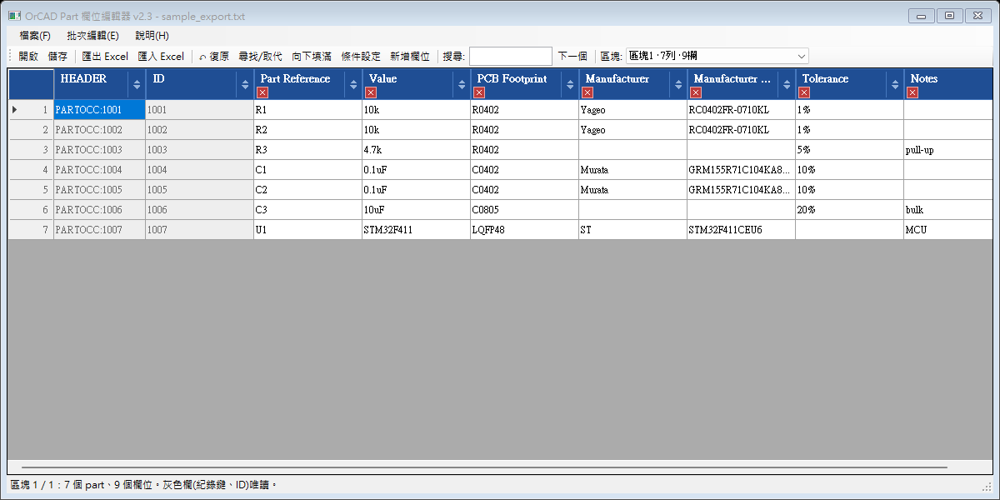

# OrCAD Part Editor v2.3

A portable Windows GUI for batch-editing OrCAD Capture part properties and round-tripping them through Excel.

OrCAD Part Editor 將 Capture 匯出的屬性文字檔載入成表格，讓你批次修改元件欄位，再安全地匯回 OrCAD。程式不需要 Python，也不依賴 Microsoft Excel。

## Features

- 開啟 OrCAD Capture Export Properties 產生的文字檔
- 保護紀錄鍵與 ID 欄，避免破壞元件對應
- 尋找/取代、向下填滿、條件設定、新增與刪除欄位
- 常用欄位優先顯示，但保留原始儲存順序
- 匯出及匯入 .xlsx，所有值均以文字處理
- 支援 Undo、排序與多區塊屬性檔
- 單一 Windows EXE；不需要安裝額外 runtime

## Quick start

1. 在 OrCAD Capture 的 Project Manager 選取設計。
2. 使用 **Tools → Export Properties** 匯出 .txt。
3. 執行 **OrcadPartEditor.exe**，按「開啟」載入檔案。
4. 編輯欄位，或從「批次編輯」使用批次操作。
5. 儲存成文字檔，再使用 **Tools → Import Properties** 匯回 Capture。

首次使用建議先用內附的 **sample_export.txt** 測試。

## Excel round-trip

匯出 Excel 時可以選擇：

- 畫面順序：常用欄位排列在前
- 原始順序：維持 OrCAD 原始 HEADER 順序

重新匯入 Excel 時會依欄名及 ID 更新資料，不會因畫面排序而錯位。空值會正規化為空字串，避免 OrCAD 對 <null> 的更新問題。

## Build

在 Windows PowerShell 執行：

~~~powershell
powershell -ExecutionPolicy Bypass -File .\build.ps1
~~~

建置腳本使用 Windows 內附的 .NET Framework C# compiler，輸出 **OrcadPartEditor.exe**。

## Verification

test/ 包含 parser、round-trip、Excel、排序、Undo、欄位刪除與顯示順序測試。測試只應使用 sample_export.txt 或自行建立的合成資料；私人 OrCAD 專案資料不應加入版本控制。

目前已針對內附 fixture 驗證：

- 屬性檔 parse / serialize 結構保留
- Unicode 與 XML 特殊字元處理
- Excel shared strings 讀取
- 畫面欄位重排不影響原始欄位索引
- XLSX XML 讀取禁止 DTD 與外部 XML resolver

## Safety and privacy

- 程式在本機處理資料，沒有網路上傳或遙測。
- 匯入前請保留原始屬性檔備份。
- 不要修改紀錄鍵與 ID；介面已將這兩欄設為唯讀。
- 不要把公司設計檔、BOM、客戶料號或真實匯出檔提交到公開 repository。
- 只開啟可信任來源的 OrCAD / Excel 檔案。

## Repository layout

~~~text
OrcadPartEditor.cs        Main application source
OrcadPartEditor.exe       Portable Windows build
build.ps1                 Build script
sample_export.txt         Synthetic demo data
docs/images/              Public-safe screenshots
test/                     Verification programs
~~~

## License

No open-source license has been selected yet. Add a license before accepting external reuse or contributions.
